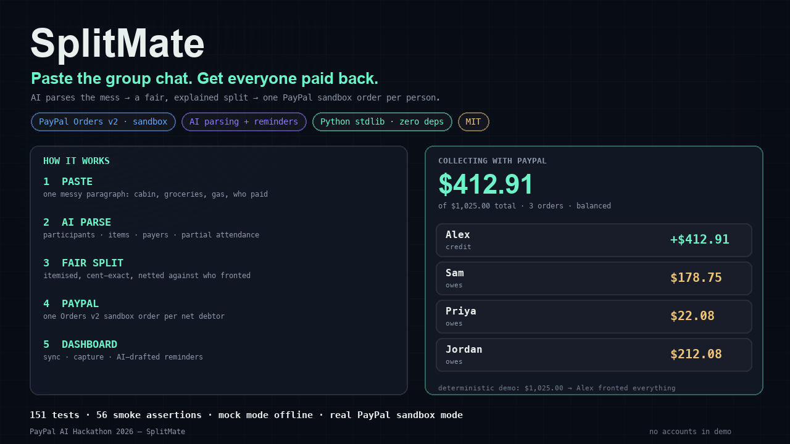
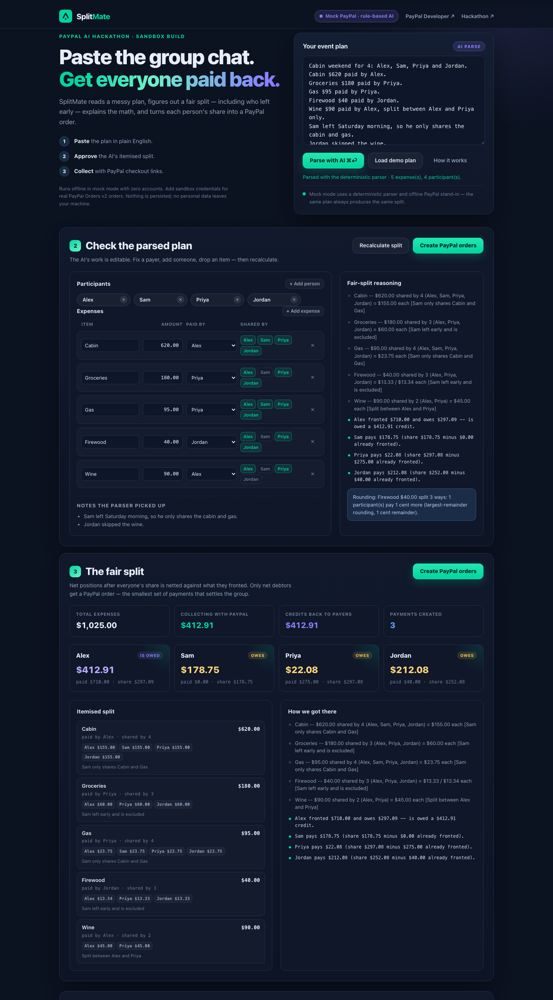
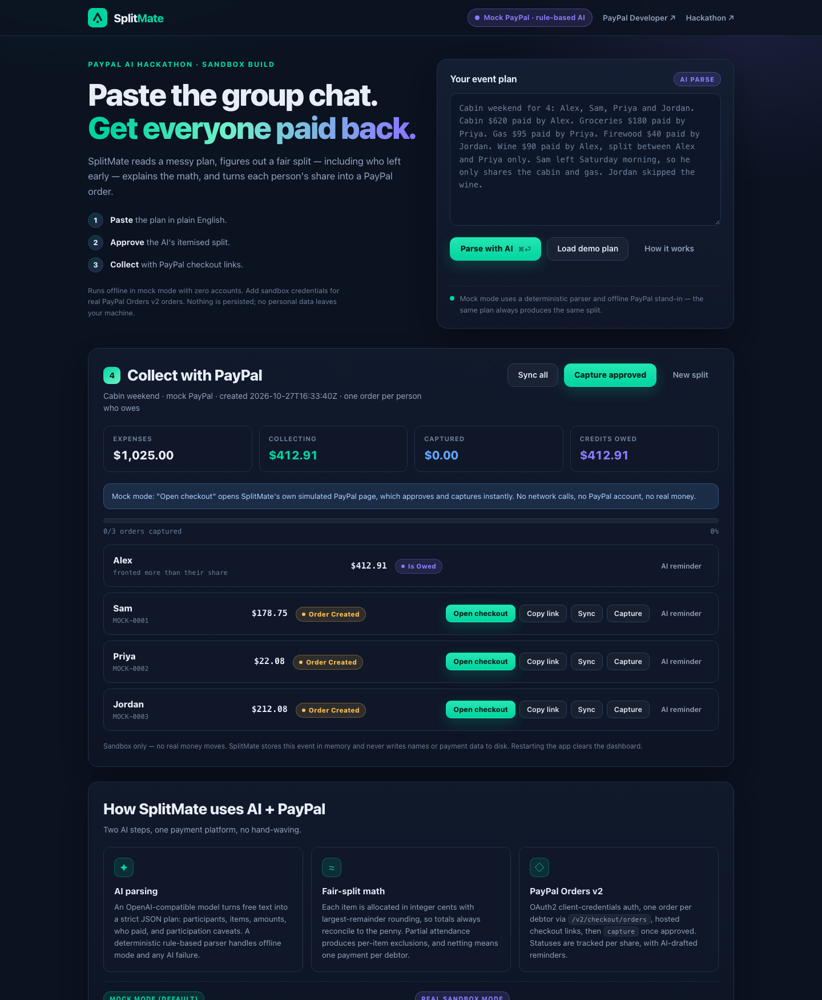

# SplitMate

**Prototype status:** the demo and validation are offline, using simulated checkout and local fake PayPal/model services. The sandbox and model adapters are implemented, but genuine sandbox capture, buyer redirects and external-model behavior have not been verified. Payment-flow descriptions below explain intended configured behavior, not completed live-provider tests.

**Turn a group-expense plan into an explained split and a sandbox payment workflow.**

SplitMate is an AI group-expense agent: paste a messy natural-language event plan, and it
parses the participants, items, amounts and "who left early" caveats, proposes a fair
itemised split, and turns each person's net share into a real **PayPal Orders v2** order in
the PayPal sandbox. The dashboard tracks every share from order created → approved →
captured, and can draft the payment reminder for you.

Built for the [PayPal AI Hackathon](https://paypalaihackathon.devpost.com/) — a working
prototype that integrates **PayPal's developer platform (sandbox)** and an **AI model/tool**.

- **Nothing to install:** Python 3.9+ standard library on the server, plain JS in the browser. No pip, no npm, no build step. The one third-party library, [AG Grid Community](https://www.ag-grid.com/) (MIT), is committed under `static/vendor/`, so it also works offline.
- **Check the AI's work before money moves:** an AG Grid allocation matrix shows each person's exact share of each item, lets you correct the AI in place, and shows whether the totals reconcile. A second AG Grid is the payment ledger.
- **Runs offline by default:** mock mode includes a deterministic AI parser fallback and a simulated PayPal checkout, so judges can click through the whole flow with no accounts, no keys and no network.
- **Sandbox adapter implemented, live validation pending:** configuration supports PayPal sandbox credentials and an optional LLM key. Tests use local fake services; genuine PayPal checkout/capture and external-model behavior have not been verified.
- **Tested:** `python3 -m unittest` → 181 tests; `make test-ui` → 37 browser-code tests; `bash scripts/smoke.sh` → 56 scripted end-to-end assertions covering mock mode **and** the real HTTP path against a local fake PayPal/LLM server.






---

## Inspiration

Every group trip ends the same way: one person fronts the cabin, another covers groceries,
someone leaves Saturday morning, and three weeks later everyone is pinging the group chat
with "who owes what?" The existing answer is a spreadsheet or a wallet app that assumes one
payer and equal splits. Real life is messier: partial attendance, a wine run only three
people joined, rounding that never quite reconciles.

Meanwhile PayPal already moves money for millions of people — and now the interesting
question is what payments look like when an AI agent can do the math *and* request the
money. SplitMate is our answer: the AI handles the messy language and the reasoning; PayPal
handles the money movement. The human stays in the loop and only approves a split once.

## What it does

1. **Paste a plan.** Free text like:

   > Cabin weekend for 4: Alex, Sam, Priya and Jordan.
   > Cabin $620 paid by Alex. Groceries $180 paid by Priya. Gas $95 paid by Priya.
   > Firewood $40 paid by Jordan. Wine $90 paid by Alex, split between Alex and Priya only.
   > Sam left Saturday morning, so he only shares the cabin and gas.
   > Jordan skipped the wine.

2. **AI parses it** into a strict JSON plan: participants, items, amounts in cents, who
   paid, who shares each item, and the participation notes. A deterministic rule-based
   parser handles mock mode and any AI failure, so the demo never dies on stage.

3. **Fair split, explained.** Every expense is allocated in integer cents with
   largest-remainder rounding (so the item always sums exactly), partial attendance narrows
   who shares what, and each person's *net* position is `paid − share`. In the AG Grid
   allocation matrix you can correct anything the AI got wrong: edit a value or click a
   person's cell, the server recalculates, and the changed cells flash while the pinned
   rows show whether the totals still reconcile.

4. **PayPal collects the difference.** On approval, SplitMate creates **one PayPal order per
   net debtor** — not one per pairwise IOU. In the demo above, a web of who-paid-what
   collapses to three orders: Sam $178.75, Priya $22.08, Jordan $212.08, with Alex receiving
   a $412.91 credit. Fewer, smaller, simpler payments.

5. **Track and nudge.** Each share is tracked order created → approved → captured. The app
   can draft a friendly reminder for any participant (LLM in real mode, deterministic
   template offline) — nothing is ever sent automatically.

6. **Demo profile in one click.** "Load demo plan" loads the deterministic sample and parses
   it. In mock mode, "Open checkout" opens SplitMate's own clearly-labelled simulated PayPal
   page so the full capture flow works offline.

## Quickstart (mock mode — offline, no accounts)

```bash
cd contest-entries/paypal
python3 app.py
# open http://127.0.0.1:8000
```

Click **Load demo plan** → **Create PayPal orders** → **Open checkout** → **Approve & pay
(simulated)** → the dashboard shows the captured share. No network requests leave your
machine in mock mode.

Run the test suite and the one-command smoke proof:

```bash
python3 -m unittest discover -s tests -t .   # 181 tests
make test-ui                                 # 37 browser-code tests (needs Node.js, no packages)
bash scripts/smoke.sh                        # or: make smoke   (56 assertions)
```

No `make`? It is just a convenience wrapper — `bash scripts/smoke.sh` is the one command.

### Real PayPal sandbox mode

1. Create a free PayPal Developer account: <https://developer.paypal.com/>.
2. In **Apps & Credentials → Sandbox**, create an app and copy its **Client ID** and
   **Secret**.
3. Configure and run:

   ```bash
   cp .env.example .env
   # edit .env: set PAYPAL_CLIENT_ID and PAYPAL_CLIENT_SECRET
   # optional for real AI parsing/reminders: LLM_API_KEY (+ LLM_BASE_URL / LLM_MODEL)
   python3 app.py
   ```

   The header pill switches to **PayPal sandbox**. "Create PayPal orders" now calls
   `POST /v2/checkout/orders` for real; "Open checkout" opens PayPal's sandbox approval page
   in a new tab. Pay with a sandbox buyer account, return to SplitMate, then **Sync** and
   **Capture** (or let the `/return` page capture automatically if PayPal appends the order
   token — see *Limitations*).

Exactly what the real client calls (all verified against PayPal's published OpenAPI schema
and authentication docs — see [RULES-NOTES.md](RULES-NOTES.md)):

| Step | Request |
| --- | --- |
| OAuth2 token | `POST {PAYPAL_BASE_URL}/v1/oauth2/token` — HTTP Basic auth, `grant_type=client_credentials` |
| Create order | `POST /v2/checkout/orders` — `intent: CAPTURE`, `purchase_units[0].amount {currency_code, value: "178.75"}`, `application_context` with return/cancel URLs |
| Read status | `GET /v2/checkout/orders/{id}` — `CREATED` / `PAYER_ACTION_REQUIRED` / `APPROVED` / `COMPLETED` |
| Capture | `POST /v2/checkout/orders/{id}/capture` — empty JSON body, returns the capture under `purchase_units[].payments.captures[]` |

### Environment variables

| Variable | Default | Purpose |
| --- | --- | --- |
| `SPLITMATE_MODE` | `auto` | `auto` (real when configured), `mock` (force offline), `real` (require PayPal creds) |
| `SPLITMATE_HOST` / `SPLITMATE_PORT` | `127.0.0.1` / `8000` | Bind address / port |
| `SPLITMATE_PUBLIC_BASE_URL` | `http://127.0.0.1:8000` | Base URL used in PayPal return/cancel URLs and mock checkout links |
| `PAYPAL_CLIENT_ID` / `PAYPAL_CLIENT_SECRET` | — | Sandbox app credentials (never logged, never returned by the API) |
| `PAYPAL_BASE_URL` | `https://api-m.sandbox.paypal.com` | PayPal REST base URL |
| `PAYPAL_CURRENCY` | `USD` | One of USD/EUR/GBP/CAD/AUD |
| `PAYPAL_EXPERIENCE_CONTEXT` | `0` | `1` = send return/cancel URLs under `payment_source.paypal.experience_context` instead of `application_context` (see RULES-NOTES) |
| `LLM_API_KEY` | — | Any OpenAI-compatible chat-completions API key (optional) |
| `LLM_BASE_URL` | `https://api.openai.com/v1` | Compatible endpoint base URL |
| `LLM_MODEL` | `gpt-4o-mini` | Model name passed to the endpoint |
| `LLM_TIMEOUT_SECONDS` | `30` | LLM request timeout |

`.env` is gitignored. `.env.example` documents every variable. Values left blank or left as
example placeholders are treated as unset, so the app still starts safely in mock mode.

## How we built it

### Architecture

```text
┌──────────────────────────── Browser (single-page UI) ───────────────────────────┐
│  static/index.html + styles.css + app.js                                        │
│  paste → edit parsed plan → approve split → PayPal checkout links → dashboard   │
└───────────────────────────────────┬────────────────────────────────────────────┘
                                    │ JSON API (fetch)
┌───────────────────────────────────▼────────────────────────────────────────────┐
│  app.py  →  splitmate/server.py  (http.server, 127.0.0.1, JSON + static files)  │
│                                                                                │
│  splitmate/service.py     in-memory events; create orders; sync/capture        │
│    ├── splitmate/parser.py    AI parse → strict plan (LLM + rule fallback)     │
│    ├── splitmate/splits.py    integer-cent largest-remainder split + netting   │
│    ├── splitmate/paypal_client.py  RealPayPalClient (Orders v2 + OAuth2)       │
│    │                               MockPayPalClient (deterministic offline)    │
│    ├── splitmate/reminders.py AI reminder drafting (LLM + template fallback)   │
│    └── splitmate/plan.py      plan schema validation / money helpers           │
└───────────────────────────────────┬────────────────────────────────────────────┘
                                    │ HTTPS (real mode only)
                        PayPal sandbox REST API  /  OpenAI-compatible LLM API
```

No frameworks, no databases, no third-party packages. State lives in memory by design: the
demo persists no personal data to disk, and restarting gives a clean dashboard.

### The AI part

Two places use AI, and both have deterministic offline fallbacks:

1. **Plan parsing.** In real mode, SplitMate sends the plan to an OpenAI-compatible
   `POST /chat/completions` with a strict JSON schema and asks for raw JSON. The response
   is validated against the same schema as everything else, and anything malformed,
   truncated or incomplete falls back to the rule-based parser with a warning. The
   deterministic parser understands the phrasings the demo relies on — `"Cabin $620 paid by
   Alex"`, `"Alex paid $120 for groceries"`, `"$1,234.56"`, `"split between Alex and Priya
   only"`, `"Sam left … so he only shares the cabin and gas"`, `"Jordan skipped the wine"` —
   plus currency symbols and partial attendance.
2. **Reminder drafting.** In real mode the same LLM drafts a short, warm reminder per
   participant; offline, a deterministic template does it. Reminders are only ever shown for
   copy/paste — SplitMate never sends messages on your behalf.

The prompt treats the pasted plan as untrusted data (it is the only user-controlled content
and is never concatenated into instructions), the LLM key never reaches the browser, and
LLM errors are sanitised before they can be displayed.

### The split math

For each expense with amount `A` shared by `n` people:

- `base, remainder = divmod(A, n)` → everyone pays `base`, the first `remainder` people in
  the plan's participant order pay one extra cent (largest-remainder method).
- `sum(shares) == A` exactly, for every item — the property is pinned by tests.
- Partial attendance is expressed as the expense's `shared_by` set (not a separate
  adjustment step), so every cent still reconciles.
- Each participant's net position is `paid − share`. Negative → they owe the pot and get a
  PayPal order for exactly that amount. Positive → they fronted money and get a credit in
  the dashboard. This netting is why one person's $7.08 leftover becomes a real order instead
  of being forgotten in a spreadsheet.

### PayPal integration

`splitmate/paypal_client.py` has two implementations of one tiny interface, which is also
how the tests stay honest: the same service code runs against the real sandbox client and
the offline mock. The real client uses `urllib.request` directly and implements:

- OAuth2 client-credentials token with Basic auth, cached until `expires_in` minus 60 s.
- Create order with `intent: CAPTURE`, a decimal-string amount, a `reference_id` that maps
  the order back to `{event_id}:{participant}`, and return/cancel URLs.
- Read order status and capture; `200` and `201` are both accepted for create/capture
  (PayPal returns `201` on first write, `200` on idempotent retries).
- Normalised errors: HTTP status, PayPal `name`, `debug_id`, `details[].issue`, and
  human-helpful messages (e.g. `ORDER_NOT_APPROVED` → "the buyer hasn't approved this order
  yet"). Credentials are never included in errors or logs.

The mock client mirrors the same states and the same interface, with deterministic order ids
(`MOCK-0001`, …) and an approve URL that points at the app's own clearly-labelled simulated
checkout page — no PayPal branding is imitated, and the page states plainly that it is a
simulation.

### Project structure

```text
contest-entries/paypal/
├── app.py                      # entry point: python3 app.py
├── splitmate/                  # stdlib-only application package
│   ├── config.py               # env/.env configuration and modes
│   ├── plan.py                 # plan schema validation + money helpers
│   ├── parser.py               # AI parser (LLM) + deterministic fallback
│   ├── splits.py               # fair-split math and netting
│   ├── paypal_client.py        # Real Orders v2 client + offline mock client
│   ├── reminders.py            # AI reminder drafting + offline template
│   ├── service.py              # event lifecycle, order creation, capture
│   ├── server.py               # HTTP server: JSON API, static UI, mock checkout
│   ├── llm.py                  # OpenAI-compatible chat-completions client
│   └── fake_services.py        # fake PayPal + LLM server used by tests/smoke
├── static/                     # single-page UI (plain HTML/CSS/JS)
│   ├── grids.js                # AG Grid allocation matrix + payment ledger
│   └── vendor/                 # unmodified AG Grid Community 36.2.0 + its MIT license
├── samples/                    # deterministic demo plan + expected split
├── scripts/smoke.sh            # one-command end-to-end proof
├── scripts/smoke_client.py     # scripted smoke assertions
├── tests/                      # 181 unittest tests + 37 browser-code tests
├── docs/screenshots/           # app screenshots (also handy as a Devpost thumbnail)
├── README.md · SUBMISSION.md · RUNBOOK.md · RULES-NOTES.md
├── LICENSE (MIT) · .env.example · .gitignore · Makefile
```

### HTTP API

| Method | Path | Purpose |
| --- | --- | --- |
| `GET` | `/` | Single-page UI |
| `GET` | `/api/health` | Active modes (mock vs sandbox, rule-based vs LLM) — no secrets |
| `GET` | `/api/demo` | Deterministic demo plan text |
| `POST` | `/api/parse` | `{text}` → plan + split preview + warnings |
| `POST` | `/api/preview` | Recompute a split for an edited plan (no orders) |
| `POST` | `/api/events` | Create event + one PayPal order per net debtor |
| `GET` | `/api/events/{id}` | Event with shares, order ids, totals |
| `POST` | `/api/events/{id}/sync` | Refresh all order statuses (`GET` order) |
| `POST` | `/api/events/{id}/capture-approved` | Capture every approved order |
| `POST` | `/api/events/{id}/shares/{name}/(sync\|capture\|retry)` | Per-share actions |
| `POST` | `/api/events/{id}/reminders` | `{name}` → AI-drafted reminder text |
| `GET` | `/api/orders/{order_id}` | Look up one order's event/share (used by PayPal return) |
| `GET` | `/mock/checkout?order=…` | Simulated checkout page (mock mode only) |
| `POST` | `/api/mock/checkout/{order_id}/approve` | Simulated approval + capture (mock mode only) |

Request bodies are capped at 256 KiB and must be JSON objects. Static file serving rejects
path traversal (including percent-encoded), NUL bytes, backslashes, unknown extensions and
oversized files. Responses carry `X-Content-Type-Options: nosniff`, `X-Frame-Options: DENY`
and `Referrer-Policy: no-referrer`.

## Challenges

- **"Fair" is harder than `total / n`.** Partial attendance, a payer who fronted money they
  don't share, and cent-level rounding all broke naive approaches. Moving to integer cents
  with largest-remainder allocation and netting by participant made the math provably
  reconcilable and much easier to explain in the UI.
- **Trusting an LLM with money-adjacent output.** The model's JSON is never used directly:
  it is schema-validated, normalised and capped, and every failure path degrades to a
  deterministic parser with a visible warning. The demo must work even if the model is
  down — judges should never see a stack trace on stage.
- **Building a real PayPal integration without credentials at build time.** We read the
  Orders v2 OpenAPI schema and the authentication docs, encoded the exact request/response
  shapes, then wrote a fake PayPal server that mirrors those shapes so the real client could
  be tested over HTTP — including the `ORDER_NOT_APPROVED` 422 path a live sandbox returns
  if you try to capture before the buyer approves.
- **Making a hackathon demo that "just runs".** Nothing to install, offline mock mode,
  one-command smoke test, deterministic sample plan. Reviewers shouldn't have to install
  anything or own a PayPal account to see the product work.
- **Limited in-memory personal data.** Plans and participant names can contain personal data. Event data is in memory only; the browser never
  sees credentials; API errors are sanitised; `.env` is gitignored; test/smoke requests run
  against local fakes instead of real accounts.

## Accomplishments

- An offline-demonstrated product loop: plan → validated structure → editable fair split
  → simulated checkout → status sync → simulated capture → reminder template.
  PayPal Orders v2 and model adapters are implemented but genuine provider behavior remains unverified.
- 181 stdlib `unittest` tests and a 56-assertion smoke script that exercise the offline
  demo and the real-mode HTTP path (OAuth header, order payload, capture flow, 409 before
  approval, token caching, error sanitisation) against a local fake PayPal/LLM server.
- A split engine that always reconciles to the cent, explains every line, and turns a
  four-person trip into three PayPal orders instead of a spreadsheet.
- A polished single-page UI with no frontend framework, no build step, and nothing loaded
  from a CDN — dark, responsive, and honest about mock vs real mode.
- An AG Grid review surface where one click re-splits the whole plan through the server's
  exact-cent engine, and the totals visibly reconcile before any order exists.
- A repo that is genuinely ready to hand to a judge: README, runbook, rules notes,
  paste-ready Devpost copy, demo video script, MIT license, `.env.example`.

## What we learned

- **PayPal Orders v2 is a clean REST API**, and the HATEOAS `links` are the real contract:
  the approve/payer-action URL comes from the create-order response, which means the client
  should never hard-code checkout URLs. The capture response nests the actual payment under
  `purchase_units[].payments.captures[]` — read the status there, not just the order status.
- **Schema evolution is real:** `application_context` is deprecated in the current Orders v2
  schema in favour of `payment_source.paypal.experience_context`. We kept the classic
  redirect flow as the default (widely compatible) and added an opt-in flag for the newer
  placement, and documented the trade-off rather than pretending it doesn't exist.
- **AI is most useful as a structured-extraction layer, not an oracle.** Constraining the
  model to JSON + validating it + falling back deterministically gave us LLM flexibility with
  script-like reliability.
- **Determinism is a feature in demos.** A fixed sample plan, fixed mock ids and exact
  integer cents mean the recorded demo and the docs match to the cent.

## What's next

- **PayPal Payouts / wallet transfers** to automatically reimburse the people who fronted
  money, closing the loop that SplitMate currently shows as dashboard credits.
- **Hosted deployment** (e.g. Render/Railway) plus a public demo URL so judges can try it
  without installing anything; real mode would use a sandbox-only app and HTTPS return URLs.
- **Webhook-driven status updates** instead of explicit sync: subscribe to PayPal
  `CHECKOUT.ORDER.APPROVED` / `PAYMENT.CAPTURE.COMPLETED` events.
- **Persistent storage** (SQLite + optional accounts) with explicit PII boundaries, so a
  group can come back weeks later.
- **Richer fairness rules**: percentage or weight-based splits, recurring expenses, refunds
  and partial captures.
- **Smarter reminders**: tone/language options, automatic escalation cadence, and payments
  via Venmo/Braintree where available.

## Built with

- **Python 3.9+ standard library** — `http.server`, `urllib.request`, `json`, `unittest`
- **PayPal Orders v2 REST API** + OAuth 2.0 client credentials (PayPal sandbox)
- **OpenAI-compatible Chat Completions API** for plan parsing and reminder drafting
- **A deterministic rule-based NLP parser** for offline mock mode and AI-failure fallback
- **AG Grid Community 36.2.0** (MIT) for the allocation matrix and payment ledger
- **Plain HTML/CSS/JavaScript** single-page UI served by the app (no framework, no build)
- **MIT License**, `.env`-based configuration, no Python packages to install

## Testing

```bash
# 181 tests across plan validation, split math, parsers (incl. LLM + fallbacks),
# PayPal request shapes/OAuth/capture/errors, HTTP endpoints and security hardening.
python3 -m unittest discover -s tests -t . -v

# 37 tests of the real browser code against a fake DOM, fake AG Grid and fake HTTP.
# Needs Node.js 18+ but no packages.
make test-ui

# One command: unit tests + fake PayPal/LLM server + mock-mode E2E + real-mode
# HTTP path (OAuth, orders, 409-before-approval, sync, capture, token caching).
bash scripts/smoke.sh          # or: make smoke
```

What the tests cover, briefly:

- **Split math:** exact-cent allocation, largest-remainder rounding, partial attendance,
  payer credit, netting to zero, only debtors get orders, determinism.
- **Parser:** demo plan structure, payer phrasings, currency detection, partial-attendance
  parsing, LLM success/failure/invalid-JSON/incomplete fallbacks, no secret leakage.
- **PayPal client:** Basic auth header, cached token + refresh, request payload shape,
  amount formatting, description limits, experience-context variant, status lifecycle,
  422 `ORDER_NOT_APPROVED` handling, idempotent capture, sanitised auth/network errors,
  order-id validation before URL interpolation.
- **HTTP:** UI and static assets, traversal and size limits, JSON error shapes, security
  headers, parse/preview/create event/flows, mock checkout approve, sync/capture endpoints,
  reminders, unknown ids, method handling, and the full real-mode path against fake services.

## Security & privacy

- No accounts, no analytics, no trackers, no third-party frontend resources.
- Event data (names, amounts) lives in memory only; nothing is persisted to disk. Restart = wipe.
- Capture observations retain selected order/capture IDs, statuses, amounts, currencies and validation diagnostics in memory. Payer email/address fields are not copied. Nonfinite numbers and object/array values in scalar evidence fields become typed markers; see [capture contract](docs/CAPTURE-OUTCOMES.md).
- Credentials come from environment variables / a gitignored `.env`; they are never logged,
  never returned by `/api/health`, and redacted from error messages.
- The LLM receives only the plan text or reminder context you submit; keys stay server-side.
- Mock mode makes no network calls at all.
- Intended for sandbox use only: endpoint configuration is not a hard sandbox enforcement boundary. Do not configure production endpoints. This hackathon prototype does not
  handle refunds, disputes, webhooks or payouts.

## Limitations / unverified details

- **Verification boundary:** 181 Python tests, 56 local fake-service smoke assertions and 37 UI logic tests exercise implemented behavior. They are not evidence of genuine PayPal sandbox approval/capture or external LLM quality. The AG Grid views were also driven in a real Chromium browser, in mock mode only; other browsers, assistive technology and a live PayPal run have not been tested.
- **Capture safety:** pending, failed, unknown or inconsistent capture observations are held for read-only reconciliation and do not count as completed payments. Never restart/recreate an event to bypass a hold. In-memory state is not restart-safe.

- Creating orders and capturing were verified against the published PayPal Orders v2
  OpenAPI schema and docs, and exercised end-to-end against a local fake server that mirrors
  them. **A live sandbox capture was not run by the build environment** (no PayPal account),
  so the first real sandbox run is a user step in `RUNBOOK.md`.
- `application_context` is marked deprecated in the current schema; the default classic
  redirect flow is kept for compatibility. The newer
  `payment_source.paypal.experience_context` placement is implemented behind
  `PAYPAL_EXPERIENCE_CONTEXT=1` but is **UNVERIFIED** against a live sandbox.
- PayPal's docs state the buyer is redirected to `return_url` after approval; the exact query
  parameters appended by PayPal are not verified here, so the app supports both a `token=`
  deep link and a manual **Sync** fallback from the dashboard.
- `response_format: {"type": "json_object"}` is standard for OpenAI chat completions but not
  universally supported by every OpenAI-compatible provider; the parser tolerates a model
  that ignores it by extracting the JSON object from the response, and falls back if it
  cannot.
- The app binds to `127.0.0.1` and is designed for local demo use; it is not hardened for
  public multi-user deployment.

See [RULES-NOTES.md](RULES-NOTES.md) for the hackathon rules we built against, verbatim
quotes with sources, and the full UNVERIFIED list.

## License

MIT — see [LICENSE](LICENSE). `Copyright (c) 2026 Brad Grubbs`.
